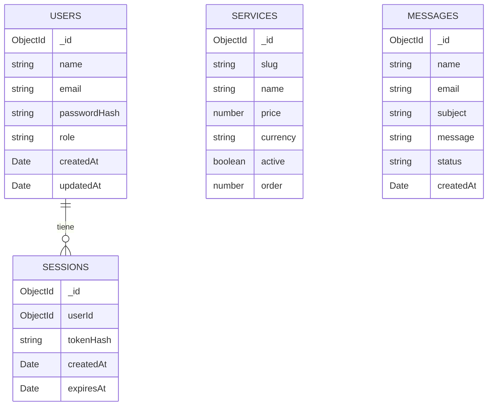

# Base de datos de Kiday Academy

Kiday Academy usa MongoDB con la base `kiday_academy`. La estructura es intencionalmente pequeña: cuatro colecciones y una relación principal entre usuarios y sesiones.

## Mapa rápido



`SERVICES` y `MESSAGES` no dependen de `USERS`; son datos públicos del catálogo y del formulario de contacto.

## Colecciones

### `users`: cuentas

Guarda administradores y estudiantes. El campo `role` decide qué puede hacer cada cuenta.

| Campo | Tipo | Descripción |
| --- | --- | --- |
| `_id` | ObjectId | Identificador interno generado por MongoDB. |
| `name` | string | Nombre visible. |
| `email` | string | Correo normalizado en minúsculas. Es único. |
| `passwordHash` | string | Hash `scrypt` con sal. Nunca se guarda la contraseña original. |
| `role` | string | `admin` o `student`. |
| `createdAt` | Date | Fecha de creación. |
| `updatedAt` | Date | Última actualización del perfil. |

Ejemplo:

```json
{
  "_id": "665f1c2a9f1b2c0012345678",
  "name": "Estudiante de ejemplo",
  "email": "estudiante@ejemplo.com",
  "passwordHash": "scrypt$sal$hash",
  "role": "student",
  "createdAt": "2026-10-27T20:00:00.000Z",
  "updatedAt": "2026-10-27T20:00:00.000Z"
}
```

### `sessions`: sesiones activas

Cada inicio de sesión crea un documento. El cliente recibe un token aleatorio; la base solo guarda su hash.

| Campo | Tipo | Descripción |
| --- | --- | --- |
| `_id` | ObjectId | Identificador de la sesión. |
| `userId` | ObjectId | Referencia a `users._id`. |
| `tokenHash` | string | SHA-256 del token. No permite reconstruir el token. |
| `createdAt` | Date | Inicio de la sesión. |
| `expiresAt` | Date | Expiración. MongoDB elimina el documento automáticamente con el índice TTL. |

Ejemplo:

```json
{
  "_id": "665f1d4b9f1b2c0012345679",
  "userId": "665f1c2a9f1b2c0012345678",
  "tokenHash": "hash-sha-256",
  "createdAt": "2026-10-27T20:05:00.000Z",
  "expiresAt": "2026-11-03T20:05:00.000Z"
}
```

### `services`: planes del catálogo

Aunque la API usa el nombre `services`, cada documento es un plan que aparece en la landing y se administra desde el panel.

| Campo | Tipo | Descripción |
| --- | --- | --- |
| `_id` | ObjectId | Identificador del plan. |
| `slug` | string | Identificador legible y único, por ejemplo `kiday-pro`. |
| `name` | string | Nombre comercial. |
| `tagline` | string | Frase corta para la tarjeta. |
| `description` | string | Descripción completa. |
| `price` | number | Precio. `0` significa gratis. |
| `currency` | string | Moneda ISO, por defecto `COP`. |
| `period` | string o null | Periodo de cobro, por ejemplo `mes` o `siempre`. |
| `features` | string[] | Beneficios mostrados en el catálogo. |
| `highlighted` | boolean | Si se destaca visualmente. |
| `active` | boolean | Si se muestra en la landing. |
| `order` | number | Orden de aparición. |
| `createdAt` | Date | Fecha de creación. |
| `updatedAt` | Date | Última edición. |

Ejemplo:

```json
{
  "_id": "665f1e5c9f1b2c0012345680",
  "slug": "kiday-pro",
  "name": "Kiday Pro",
  "tagline": "Para quienes quieren ir un paso más allá",
  "description": "Incluye todas las herramientas de estudio y el asistente IA.",
  "price": 19900,
  "currency": "COP",
  "period": "mes",
  "features": ["Materias ilimitadas", "Kiday IA", "Promediador avanzado"],
  "highlighted": true,
  "active": true,
  "order": 2,
  "createdAt": "2026-10-27T20:10:00.000Z",
  "updatedAt": "2026-10-27T20:10:00.000Z"
}
```

### `messages`: contacto

Guarda los envíos del formulario público. El panel administrativo los lee y cambia su estado.

| Campo | Tipo | Descripción |
| --- | --- | --- |
| `_id` | ObjectId | Identificador del mensaje. |
| `name` | string | Nombre de quien escribe. |
| `email` | string | Correo de contacto. |
| `subject` | string | Asunto o plan de interés. |
| `message` | string | Contenido del mensaje. |
| `status` | string | `nuevo`, `leido` o `respondido`. |
| `createdAt` | Date | Fecha de recepción. |
| `updatedAt` | Date | Último cambio de estado. |

Ejemplo:

```json
{
  "_id": "665f1f6d9f1b2c0012345681",
  "name": "Ana Pérez",
  "email": "ana@ejemplo.com",
  "subject": "Quiero información de Kiday Pro",
  "message": "Hola, quiero saber si el plan Pro incluye el asistente de IA.",
  "status": "nuevo",
  "createdAt": "2026-10-27T20:15:00.000Z",
  "updatedAt": "2026-10-27T20:15:00.000Z"
}
```

La colección puede verse vacía hasta que alguien envíe el formulario de contacto.

## Índices

| Colección | Índice | Para qué sirve |
| --- | --- | --- |
| `users` | `email` único | Evitar cuentas duplicadas y acelerar el login. |
| `users` | `role + createdAt` | Contar estudiantes y administradores. |
| `sessions` | `tokenHash` único | Buscar una sesión por token. |
| `sessions` | `expiresAt` TTL | Borrar sesiones vencidas automáticamente. |
| `sessions` | `userId` | Encontrar o limpiar las sesiones de un usuario. |
| `services` | `slug` único | Evitar planes duplicados. |
| `services` | `active + order` | Cargar el catálogo en el orden correcto. |
| `messages` | `createdAt` descendente | Mostrar primero los mensajes recientes. |
| `messages` | `status + createdAt` | Filtrar por estado sin perder el orden. |

Los índices se crean automáticamente al iniciar la API mediante `ensureIndexes()` en `backend/src/db.js`.

## Qué no está en MongoDB

Las materias y tareas del panel de estudiante se guardan en `localStorage`, separadas por usuario con una clave como `kiday-study-workspace-v1:<id>`. No se envían a MongoDB todavía. El chat de IA tampoco se almacena.

Esto significa que:

- El catálogo, las cuentas, las sesiones y el contacto sí son datos reales del backend.
- Las materias y tareas son datos locales del navegador.
- Si se borra el almacenamiento del navegador, se pierden esas materias y tareas.
- Para sincronizarlas entre dispositivos habría que crear colecciones `subjects` y `tasks` y endpoints protegidos.

## Cómo inspeccionarla

### Desde el proyecto

```bash
cd backend
npm run db:inspect
```

El comando muestra la base, cada colección, su propósito, cantidad de documentos, campos, tipos, índices y un ejemplo. Oculta `passwordHash` y `tokenHash` para que la salida se pueda compartir sin exponer credenciales.

### Desde MongoDB Atlas

1. Entra al clúster.
2. Abre **Browse Collections**.
3. Selecciona la base `kiday_academy`.
4. Haz clic en una colección para ver sus documentos.

### Desde MongoDB Compass

1. Conecta Compass con la misma cadena `MONGO_URL`.
2. Abre `kiday_academy`.
3. Usa la pestaña **Indexes** para revisar los índices.

## Reglas para modificarla sin romper la app

- No edites `passwordHash` ni `tokenHash` manualmente. Usa el registro, el login o el seed.
- No cambies el `slug` de un plan sin revisar enlaces o referencias.
- No elimines un usuario sin borrar también sus sesiones; aunque la API las invalida al no encontrar el usuario, es más limpio limpiarlas.
- Usa el panel administrativo para editar planes y mensajes.
- `npm run seed` es idempotente para los planes y no duplica el administrador existente.
- Si necesitas reiniciar datos de prueba, elimina primero los documentos y vuelve a ejecutar el seed.

## Estructura recomendada a futuro

Si el proyecto crece, el siguiente paso natural es:

```text
users
sessions
services
messages
subjects       # materias por usuario
tasks          # tareas por usuario
```

Con relaciones `subjects.userId -> users._id` y `tasks.userId -> users._id`, además de `tasks.subjectId -> subjects._id`. Eso permitiría sincronizar el espacio académico entre dispositivos sin cambiar el modelo actual de autenticación.
