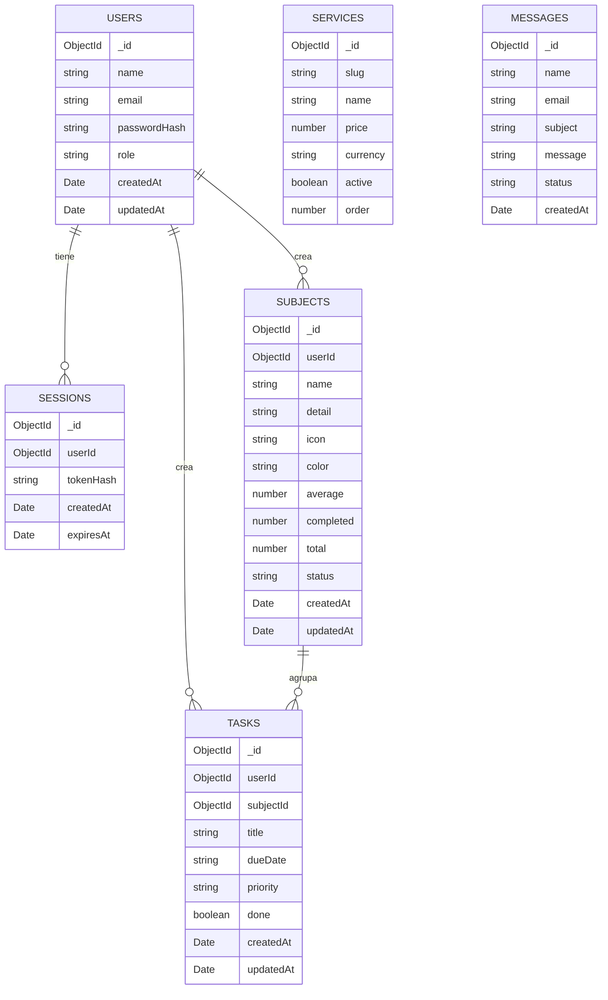

# Base de datos de Kiday Academy

Kiday Academy usa MongoDB con la base `kiday_academy`. La estructura es intencionalmente pequeña: seis colecciones, con relaciones claras entre usuarios, sesiones, materias y tareas.

## Mapa rápido



`SERVICES` y `MESSAGES` no dependen de `USERS`; son datos públicos del catálogo y del formulario de contacto. `SUBJECTS` y `TASKS` siempre pertenecen a un usuario y se consultan filtrando por `userId`.

## Colecciones

### `users`: cuentas

Guarda administradores y estudiantes. El campo `role` decide qué puede hacer cada cuenta.

| Campo | Tipo | Descripción |
| --- | --- | --- |
| `_id` | ObjectId | Identificador interno generado por MongoDB. |
| `name` | string | Nombre visible completo (`firstName` + `lastName`). |
| `firstName` | string | Nombre(s) del estudiante. |
| `lastName` | string | Apellido(s) del estudiante. |
| `birthDate` | string | Fecha de nacimiento en formato `YYYY-MM-DD`. No se guarda la edad; se calcula al leer el perfil. |
| `institution` | string \| null | Colegio, universidad o academia. Opcional. |
| `grade` | string \| null | Grado o semestre. Opcional. |
| `profileCompletedAt` | Date | Momento en que se completó el formulario de datos personales. |
| `email` | string | Correo normalizado en minúsculas. Es único. |
| `passwordHash` | string | Hash `scrypt` con sal. Nunca se guarda la contraseña original. |
| `role` | string | `admin` o `student`. |
| `plan` | string | Solo estudiantes. `kiday-free`, `kiday-pro` o `kiday-academy`. Si falta, la API lo trata como `kiday-free`. |
| `planStartedAt` | Date | Fecha desde la que está activo el plan actual. Opcional. |
| `createdAt` | Date | Fecha de creación. |
| `updatedAt` | Date | Última actualización del perfil. |

Ejemplo:

```json
{
  "_id": "665f1c2a9f1b2c0012345678",
  "name": "Estudiante de ejemplo",
  "firstName": "Estudiante",
  "lastName": "De Ejemplo",
  "birthDate": "2005-05-15",
  "institution": "Colegio Kiday",
  "grade": "11.º",
  "profileCompletedAt": "2026-10-27T20:00:00.000Z",
  "email": "estudiante@ejemplo.com",
  "passwordHash": "scrypt$sal$hash",
  "role": "student",
  "plan": "kiday-academy",
  "planStartedAt": "2026-11-07T20:00:00.000Z",
  "createdAt": "2026-10-27T20:00:00.000Z",
  "updatedAt": "2026-11-07T20:00:00.000Z"
}
```

El perfil se refleja en `publicUser()` junto con la edad calculada, el plan y la lista de capacidades desbloqueadas; nunca se expone `passwordHash`. Para cambiar el plan de una cuenta existente:

```bash
cd backend
npm run plan:set -- correo@ejemplo.com kiday-academy
```

### `sessions`: sesiones activas

Cada inicio de sesión crea un documento. El cliente recibe un token aleatorio; la base solo guarda su hash.

| Campo | Tipo | Descripción |
| --- | --- | --- |
| `_id` | ObjectId | Identificador de la sesión. |
| `userId` | ObjectId | Referencia a `users._id`. |
| `tokenHash` | string | SHA-256 del token. No permite reconstruir el token. |
| `createdAt` | Date | Inicio de la sesión. |
| `expiresAt` | Date | Expiración. MongoDB elimina el documento automáticamente con el índice TTL. |

Ejemplo:

```json
{
  "_id": "665f1d4b9f1b2c0012345679",
  "userId": "665f1c2a9f1b2c0012345678",
  "tokenHash": "hash-sha-256",
  "createdAt": "2026-10-27T20:05:00.000Z",
  "expiresAt": "2026-11-03T20:05:00.000Z"
}
```

### `subjects`: materias del estudiante

Cada materia pertenece a una cuenta. El dashboard, la página de materias y las tareas consumen estos documentos a través de la API protegida.

| Campo | Tipo | Descripción |
| --- | --- | --- |
| `_id` | ObjectId | Identificador de la materia. |
| `userId` | ObjectId | Referencia a `users._id`. Aísla los datos entre estudiantes. |
| `name` | string | Nombre de la materia. |
| `detail` | string | Detalle corto, por ejemplo `Parcial 1`. |
| `icon` | string | Iniciales para la interfaz, por ejemplo `AL`. |
| `color` | string | Gradiente de Tailwind usado en la tarjeta. |
| `average` | number | Promedio entre `0` y `5`, redondeado a un decimal. |
| `completed` | number | Actividades completadas. |
| `total` | number | Total de actividades. |
| `status` | string | `al-dia`, `pendiente` o `atrasada`. |
| `createdAt` | Date | Fecha de creación. |
| `updatedAt` | Date | Última edición. |

Ejemplo:

```json
{
  "_id": "665f206e9f1b2c0012345682",
  "userId": "665f1c2a9f1b2c0012345678",
  "name": "Álgebra lineal",
  "detail": "Parcial 1",
  "icon": "AL",
  "color": "from-violet-500 to-indigo-500",
  "average": 4.2,
  "completed": 1,
  "total": 3,
  "status": "al-dia",
  "createdAt": "2026-10-27T20:20:00.000Z",
  "updatedAt": "2026-10-27T20:20:00.000Z"
}
```

### `tasks`: tareas y recordatorios

Cada tarea pertenece a un usuario y puede estar asociada a una materia. Si se elimina la materia, la API elimina también sus tareas para mantener la coherencia.

| Campo | Tipo | Descripción |
| --- | --- | --- |
| `_id` | ObjectId | Identificador de la tarea. |
| `userId` | ObjectId | Referencia a `users._id`. |
| `subjectId` | ObjectId o null | Referencia opcional a `subjects._id`. |
| `title` | string | Descripción de la tarea. |
| `dueDate` | string | Fecha límite en formato `AAAA-MM-DD`. |
| `priority` | string | `alta`, `media` o `baja`. |
| `done` | boolean | Si la tarea está completada. |
| `createdAt` | Date | Fecha de creación. |
| `updatedAt` | Date | Última edición. |

Ejemplo:

```json
{
  "_id": "665f217f9f1b2c0012345683",
  "userId": "665f1c2a9f1b2c0012345678",
  "subjectId": "665f206e9f1b2c0012345682",
  "title": "Resolver taller de matrices",
  "dueDate": "2026-12-01",
  "priority": "alta",
  "done": false,
  "createdAt": "2026-10-27T20:25:00.000Z",
  "updatedAt": "2026-10-27T20:25:00.000Z"
}
```

### `services`: planes del catálogo

Aunque la API usa el nombre `services`, cada documento es un plan que aparece en la landing y se administra desde el panel.

| Campo | Tipo | Descripción |
| --- | --- | --- |
| `_id` | ObjectId | Identificador del plan. |
| `slug` | string | Identificador legible y único, por ejemplo `kiday-pro`. |
| `name` | string | Nombre comercial. |
| `tagline` | string | Frase corta para la tarjeta. |
| `description` | string | Descripción completa. |
| `price` | number | Precio. `0` significa gratis. |
| `currency` | string | Moneda ISO, por defecto `COP`. |
| `period` | string o null | Periodo de cobro, por ejemplo `mes` o `siempre`. |
| `features` | string[] | Beneficios mostrados en el catálogo. |
| `highlighted` | boolean | Si se destaca visualmente. |
| `active` | boolean | Si se muestra en la landing. |
| `order` | number | Orden de aparición. |
| `createdAt` | Date | Fecha de creación. |
| `updatedAt` | Date | Última edición. |

Ejemplo:

```json
{
  "_id": "665f1e5c9f1b2c0012345680",
  "slug": "kiday-pro",
  "name": "Kiday Pro",
  "tagline": "Para quienes quieren ir un paso más allá",
  "description": "Incluye todas las herramientas de estudio y el asistente IA.",
  "price": 19900,
  "currency": "COP",
  "period": "mes",
  "features": ["Materias ilimitadas", "Kiday IA", "Promediador avanzado"],
  "highlighted": true,
  "active": true,
  "order": 2,
  "createdAt": "2026-10-27T20:10:00.000Z",
  "updatedAt": "2026-10-27T20:10:00.000Z"
}
```

### `messages`: contacto

Guarda los envíos del formulario público. El panel administrativo los lee y cambia su estado.

| Campo | Tipo | Descripción |
| --- | --- | --- |
| `_id` | ObjectId | Identificador del mensaje. |
| `name` | string | Nombre de quien escribe. |
| `email` | string | Correo de contacto. |
| `subject` | string | Asunto o plan de interés. |
| `message` | string | Contenido del mensaje. |
| `status` | string | `nuevo`, `leido` o `respondido`. |
| `createdAt` | Date | Fecha de recepción. |
| `updatedAt` | Date | Último cambio de estado. |

Ejemplo:

```json
{
  "_id": "665f1f6d9f1b2c0012345681",
  "name": "Ana Pérez",
  "email": "ana@ejemplo.com",
  "subject": "Quiero información de Kiday Pro",
  "message": "Hola, quiero saber si el plan Pro incluye el asistente de IA.",
  "status": "nuevo",
  "createdAt": "2026-10-27T20:15:00.000Z",
  "updatedAt": "2026-10-27T20:15:00.000Z"
}
```

La colección puede verse vacía hasta que alguien envíe el formulario de contacto.

## Índices

| Colección | Índice | Para qué sirve |
| --- | --- | --- |
| `users` | `email` único | Evitar cuentas duplicadas y acelerar el login. |
| `users` | `role + createdAt` | Contar estudiantes y administradores. |
| `sessions` | `tokenHash` único | Buscar una sesión por token. |
| `sessions` | `expiresAt` TTL | Borrar sesiones vencidas automáticamente. |
| `sessions` | `userId` | Encontrar o limpiar las sesiones de un usuario. |
| `subjects` | `userId + createdAt` | Cargar las materias de un estudiante en orden. |
| `tasks` | `userId + dueDate` | Cargar las tareas de un estudiante por fecha. |
| `tasks` | `userId + done` | Separar pendientes de completadas. |
| `tasks` | `userId + subjectId` | Encontrar y eliminar las tareas de una materia. |
| `services` | `slug` único | Evitar planes duplicados. |
| `services` | `active + order` | Cargar el catálogo en el orden correcto. |
| `messages` | `createdAt` descendente | Mostrar primero los mensajes recientes. |
| `messages` | `status + createdAt` | Filtrar por estado sin perder el orden. |

Los índices se crean automáticamente al iniciar la API mediante `ensureIndexes()` en `backend/src/db.js`.

## Sincronización del espacio académico

Las materias y tareas ya no son la fuente de verdad del navegador. El flujo es:

1. El estudiante inicia sesión y recibe un token.
2. El frontend llama a `GET /api/workspace` con `Authorization: Bearer <token>`.
3. La API filtra `subjects` y `tasks` por el `userId` de la sesión.
4. Cada creación, edición o eliminación se guarda en MongoDB y actualiza la interfaz.
5. El navegador conserva una copia `kiday-study-workspace-v2:<id>` solo como caché para mostrar datos mientras sincroniza.

La API nunca acepta `userId` desde el cliente: lo obtiene de la sesión. Por eso un estudiante no puede leer ni modificar materias de otra cuenta.

### Migración desde la versión local

La versión anterior guardaba todo en `kiday-study-workspace-v1`. Para no perder esos datos:

- Si la cuenta no tiene materias ni tareas en MongoDB, el frontend intenta importar el caché local con `POST /api/workspace/import`.
- La importación conserva los identificadores locales para relacionar materias y tareas.
- Después de importar, se marca `kiday-study-workspace-v2-migrated:<id>` para no repetir el proceso.
- Si la cuenta ya tiene datos en MongoDB, el servidor manda y no se importa nada encima.
- El usuario puede seguir usando la app aunque falle la importación; verá un aviso y podrá reintentar.

## Qué no está en MongoDB

El historial del chat de IA no se almacena. Las conversaciones viven únicamente en el estado de la página del asistente. El catálogo, las cuentas, las sesiones, el contacto, las materias y las tareas sí son datos reales del backend.

## Cómo inspeccionarla

### Desde el proyecto

```bash
cd backend
npm run db:inspect
```

El comando muestra la base, cada colección, su propósito, cantidad de documentos, campos, tipos, índices y un ejemplo. Oculta `passwordHash` y `tokenHash` para que la salida se pueda compartir sin exponer credenciales.

### Desde MongoDB Atlas

1. Entra al clúster.
2. Abre **Browse Collections**.
3. Selecciona la base `kiday_academy`.
4. Haz clic en una colección para ver sus documentos.

### Desde MongoDB Compass

1. Conecta Compass con la misma cadena `MONGO_URL`.
2. Abre `kiday_academy`.
3. Usa la pestaña **Indexes** para revisar los índices.

## Reglas para modificarla sin romper la app

- No edites `passwordHash` ni `tokenHash` manualmente. Usa el registro, el login o el seed.
- No cambies el `slug` de un plan sin revisar enlaces o referencias.
- No elimines un usuario sin borrar también sus sesiones, materias y tareas.
- Usa el panel administrativo para editar planes y mensajes.
- Usa la API para modificar materias y tareas; así se respetan las validaciones y la separación por usuario.
- `npm run seed` es idempotente para los planes y no duplica el administrador existente.
- Si necesitas reiniciar datos de prueba, elimina primero los documentos y vuelve a ejecutar el seed.
